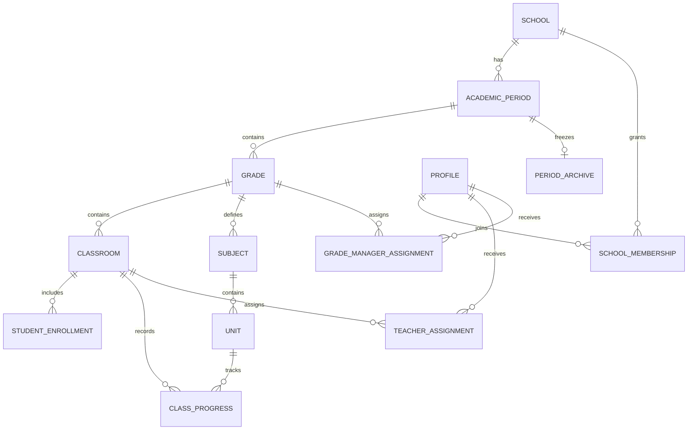
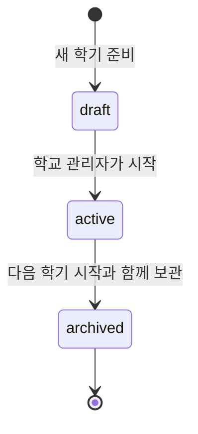

# 학급 진도 대시보드 설계서

작성일: 2026-10-07 · 문서 상태: 구현 전 설계 초안

초등학교 선생님이 담당 학급의 과목별 단원 진도를 기록하고, 같은 학년의 학급별 진도를 비교하는 웹 프로그램이다. 여러 학교가 서비스를 함께 사용하되 학교별 데이터를 분리한다. 학생 명단과 공통 단원은 학년 관리자가 관리하고, 학기 종료 시 그 학기의 학급 정보와 진도를 읽기 전용으로 보관한다.

요구사항의 기준은 [PRD.md](../PRD.md)와 2026-10-07에 확정한 추가 요구사항이다. 서로 겹치는 내용은 아래의 확정 사항을 우선한다. 개발 단계와 검증 기준은 [개발 계획서](PLAN.md)에 정의한다.

## 1. 확정한 요구사항

| 번호 | 요구사항 | 설계 반영 |
| --- | --- | --- |
| R01 | 아이디와 비밀번호로 로그인한다. | 관리자 발급 계정과 로그인 화면 |
| R02 | 선생님은 학년 대시보드, 학급 대시보드를 사용한다. 학생 상세 화면은 추후 개발한다. | 첫 버전은 두 대시보드와 담당 학급 명단 조회 제공 |
| R03 | 일반 선생님은 학생과 과목별 단원 정보를 생성·수정·삭제할 수 없다. 선생님 중에서는 학년 관리자만 가능하다. | 명단·교육과정 관리 메뉴와 서버 쓰기 권한 제한 |
| R04 | 학년 관리자가 수정한 단원 정보는 해당 학년 전체에 함께 적용한다. | 학교·학년도·학기·학년별 공통 교육과정 |
| R05 | 과목별 진도율은 완료 단원 수를 전체 단원 수로 나누어 계산한다. | 동일한 계산 규칙을 모든 화면에 적용 |
| R06 | 새 학기를 시작할 때 기존 진도와 학급 정보를 연도·학기별로 보관한다. | 학기 단위 데이터와 보관 처리 |
| R07 | 일반 선생님은 같은 학년 다른 반의 진도만 조회한다. 다른 학교·학년 정보는 볼 수 없다. | 역할과 소속 범위를 함께 검사 |
| R08 | 학교 관리자는 자기 학교의 학년·학급·선생님과 담당 권한을 관리한다. 학교는 생성할 수 없다. | 학교 관리 화면 |
| R09 | 사이트 관리자는 모든 학교와 학교 관리자를 관리한다. | 사이트 관리 화면 |
| R10 | 사이트 관리자는 학교별 사용 현황, 하루 접속량, 현재 접속 인원을 확인한다. | 이용 통계와 최근 활동 집계 |
| R11 | 기능을 설명하는 사용 설명서가 있다. | 역할별 설명서와 화면별 도움말 |

R03의 제한은 선생님 역할 간 구분이다. PRD에 명시된 사이트 관리자와 학교 관리자의 관리 권한은 각자의 관리 범위 안에서 유지한다. 보관 완료된 학기는 관리자도 일반 수정 기능으로 변경하지 못하도록 설계한다.

## 2. 첫 버전의 범위

첫 버전은 로그인, 학교·학년·학급 구성, 담당 배정, 학년 관리자 지정, 학생 명단 관리, 공통 과목·단원 관리, 학급 진도 체크, 학년별 진도 비교, 학기 보관·조회, 사용 통계, 설명서를 포함한다.

학생 이름과 번호를 관리하는 명단 기능은 첫 버전에 포함한다. 학생 상세 화면과 개인별 성적·학습 진도·상담 기록은 별도 후속 범위다. 학생이나 학부모의 로그인, 과제 제출, 출결, 외부 학교 시스템 연동, 엑셀 일괄 등록·다운로드도 첫 버전에는 포함하지 않는다.

학생 명단은 진도율 계산에 사용하지 않는다. 진도는 학생 개인이 아닌 학급 단위 기록이다.

## 3. 역할과 접근 권한

### 3.1 역할의 적용 범위

| 역할 | 부여 주체 | 적용 범위 |
| --- | --- | --- |
| 사이트 관리자 | 최초 운영 설정 또는 기존 사이트 관리자 | 전체 학교 |
| 학교 관리자 | 사이트 관리자 | 지정된 학교 |
| 선생님 | 학교 관리자 또는 사이트 관리자 | 지정된 학기의 담당 학급과 소속 학년 |
| 학년 관리자 | 학교 관리자 또는 사이트 관리자 | 지정된 학기의 해당 학년 |

학년 관리자는 별도 계정 종류가 아니라 선생님에게 추가하는 권한이다. 자기 반의 진도 체크 권한은 그대로 유지하며, 같은 학년 전체의 학생 명단과 공통 교육과정을 관리한다. 다른 반의 진도 체크를 대신 수정하는 권한은 추가하지 않는다.

설계 기본안으로 선생님은 한 학기에 한 학급을 담당하고, 학급마다 담임 한 명을 배정한다. 사용하는 학년마다 학년 관리자 한 명을 지정한다. 교체 시 기존 지정 해제와 새 지정을 한 번에 처리한다. 복수 담임·여러 학년 겸임이 필요하면 이 배정 규칙을 확장한다.

### 3.2 권한표

아래 표의 관리에는 생성·조회·수정·삭제가 포함된다. 기록이 연결된 데이터의 삭제는 7장의 비활성화 정책을 따른다.

| 작업 | 일반 선생님 | 학년 관리자 | 학교 관리자 | 사이트 관리자 |
| --- | --- | --- | --- | --- |
| 학교 생성 및 학교 관리자 배정 | 불가 | 불가 | 불가 | 전체 관리 |
| 학년·학급 생성 및 교사 배정 | 불가 | 불가 | 자기 학교 관리 | 전체 관리 |
| 학년 관리자 지정·교체 | 불가 | 불가 | 자기 학교 관리 | 전체 관리 |
| 학급 진도 조회 | 담당 반 및 같은 학년 | 담당 학년 | 자기 학교 | 전체 |
| 학급 진도 체크·해제 | 담당 반 | 담당 반 | 자기 학교 | 전체 |
| 학생 명단 조회 | 담당 반 | 담당 학년 | 자기 학교 | 전체 |
| 학생 명단 생성·수정·삭제 | 불가 | 담당 학년 관리 | 자기 학교 관리 | 전체 관리 |
| 과목·단원 목록 조회 | 소속 학년 | 담당 학년 | 자기 학교 | 전체 |
| 과목·단원 생성·수정·삭제 | 불가 | 담당 학년 관리 | 자기 학교 관리 | 전체 관리 |
| 새 학기 준비 및 전환 | 불가 | 불가 | 자기 학교 | 전체 |
| 보관 학기 조회 | 과거 배정 범위 안에서 조회 | 과거 배정 범위 안에서 조회 | 자기 학교 | 전체 |
| 보관 학기 일반 수정 | 불가 | 불가 | 불가 | 불가 |
| 전체 사이트 및 학교별 이용 통계 | 불가 | 불가 | 첫 버전 제공 범위 밖 | 전체 |
| 사용 설명서 | 조회 | 조회 | 조회 | 조회 |

학생 상세 화면을 추가할 때 일반 선생님은 담당 반 학생만 조회한다. 현재는 상세 화면으로 이동하는 비활성 메뉴를 노출하지 않는다.

### 3.3 서버와 데이터베이스에서의 권한 검사

메뉴를 숨기는 것과 별도로 모든 조회·변경 요청에서 다음을 검사한다.

1. 로그인 세션과 계정이 유효하고 활성 상태인지 확인한다.
2. 현재 학교 소속이 유효한지 확인한다. 사이트 관리자만 학교 범위를 넘을 수 있다.
3. 요청 대상의 학교·학기·학년·학급 관계를 데이터베이스에서 확인한다.
4. 사용자의 역할과 배정이 해당 작업을 허용하는지 확인한다.
5. 변경 요청이면 대상 학기의 상태와 변경 가능한 필드를 검사한다.

브라우저가 보낸 `school_id`, 역할명 또는 숨겨진 버튼 상태를 권한의 근거로 삼지 않는다. 학교·학년·학급 식별자를 바꿔 호출해도 접근할 수 없어야 한다. 학생 목록과 진도 집계를 분리하여 다른 반 진도 응답에 학생 이름이 섞이지 않게 한다.

배정 해제, 관리자 권한 회수, 계정 비활성화는 다음 요청부터 반영한다. 오래된 로그인 토큰에 담긴 역할만으로 계속 허용하지 않는다. 비밀번호 초기화 후 변경이 필요한 계정은 비밀번호 변경과 로그아웃 외의 업무 요청을 차단한다.

과거 학기 조회의 기본안은 **현재 해당 학교 소속이 활성 상태이고, 조회하려는 학기에 실제로 배정됐던 범위**로 제한하는 것이다. 일반 선생님은 당시 담당 반 명단과 당시 학년 진도를 볼 수 있다. 당시 학년 관리자는 해당 학년 명단을 볼 수 있으며, 별도 이력 열람 권한 회수도 가능하게 한다. 현재 배정만으로 다른 과거 학년의 정보를 새롭게 볼 수는 없다.

## 4. 주요 사용 흐름

### 4.1 최초 학교 개설

1. 사이트 관리자가 학교와 학교 관리자 계정을 만든다.
2. 학교 관리자가 학년도·학기, 운영할 학년, 학급을 등록한다.
3. 학교 관리자가 선생님 계정을 만들고 담당 학급과 학년 관리자를 배정한다.
4. 학년 관리자가 학급별 학생 명단과 학년 공통 과목·단원을 준비한다.
5. 학교 관리자가 준비 상태를 확인하고 학기를 활성화한다.

준비 중인 학기에서도 배정된 학년 관리자는 명단과 단원을 편집할 수 있다. 선생님의 진도 체크는 학기 활성화 후 가능하다. 최초 활성화에는 이전 학기 보관 절차가 필요하지 않다.

### 4.2 일상적인 진도 기록

1. 선생님이 로그인하면 현재 학기 담당 반 대시보드로 이동한다.
2. 과목을 펼쳐 완료한 단원을 체크하거나 체크를 해제한다.
3. 저장 성공 후 해당 과목의 완료 수와 진도율을 갱신한다.
4. 학년 대시보드에서 같은 학년 다른 반의 과목별 진도를 비교한다.

저장 중에는 해당 항목의 중복 입력을 막고 상태를 표시한다. 실패하면 체크 상태를 되돌리고 재시도 방법을 보여준다. 새로고침 뒤에도 서버에 저장된 동일한 결과가 표시되어야 한다.

### 4.3 학년 공통 단원 변경

1. 학년 관리자가 과목·단원 관리 화면에서 변경한다.
2. 저장 전에 적용 학년도·학기·학년과 영향받는 학급 수를 보여준다.
3. 공통 단원 목록을 한 번 수정하고 해당 학년의 모든 학급에 반영한다.
4. 학급별 완료 기록은 유지하되, 변경 후 유효한 단원 목록으로 진도율을 계산한다.

예를 들어 전체 10개 단원 중 4개를 완료한 반에 새 단원을 하나 추가하면 `4/11 = 36.4%`가 된다. 기존 단원의 제목만 고치면 완료 상태와 진도율은 그대로다. 다른 학년·학교·학기의 단원은 바뀌지 않는다.

## 5. 화면과 메뉴

화면별 배치, 이동 경로와 버튼·상태 동작은 [와이어프레임](WIREFRAMES.md)에 정의한다.

### 5.1 공통 화면

상단에 학교, 학년도·학기, 학년·학급, 사용자 역할을 표시한다. 선택기는 접근 가능한 항목만 보여준다. 보관 학기에는 모든 화면에 `보관된 학기 · 읽기 전용` 표시를 유지한다.

| 화면 | 주요 내용과 동작 |
| --- | --- |
| 로그인 | 아이디, 비밀번호, 로그인 오류, 관리자에게 초기화 요청하는 안내 |
| 비밀번호 변경 | 초기 비밀번호 변경과 로그인한 사용자의 비밀번호 변경 |
| 배정 대기 | 계정은 있으나 담당 학급이 없는 경우 학교 관리자에게 문의할 안내 |
| 사용 설명서 | 역할별 시작 방법, 진도 체크, 단원 변경의 영향, 학기 보관 안내 |

### 5.2 선생님 화면

| 화면 | 주요 내용 | 편집 범위 |
| --- | --- | --- |
| 학급 대시보드 | 과목명, 단원 체크박스, 완료 수, 진도율, 최근 변경 시각, 담당 반 명단 | 담당 반 진도만 체크·해제 |
| 학년 대시보드 | 행은 학급, 열은 과목인 비교표, 완료 수와 진도율, 과목 필터 | 조회 전용 |
| 학급 진도 보기 | 같은 학년 다른 반의 과목별 단원 완료 여부 | 조회 전용, 학생 정보 제외 |

학급 대시보드 구성 예시:

```text
우리초등학교   2026학년도 2학기   3학년 2반

학급 대시보드   학년 대시보드   사용 설명서

과목       완료 단원          진도율
국어       3 / 8              37.5%
  [✓] 1단원  작품을 만나요
  [✓] 2단원  중심 생각을 찾아요
  [ ] 3단원  경험을 나눠요
  ... 나머지 단원
수학       4 / 10             40.0%

담당 반 학생 명단   이름 / 번호   조회 전용
```

예시 단원명은 화면 설명용이며 실제 교과서 교육과정으로 간주하지 않는다.

### 5.3 학년 관리자 추가 화면

| 화면 | 주요 내용 |
| --- | --- |
| 학생 명단 관리 | 해당 학년의 반 선택, 학생 추가·수정·제외, 반 이동 |
| 과목 및 단원 관리 | 과목 추가·이름 변경·순서 변경·비활성화, 단원 추가·이름 변경·순서 변경·비활성화 |

학생 명단은 선택한 반에만 적용한다. 교육과정은 해당 학년 전체에 적용한다. 두 화면 모두 적용 범위를 저장 버튼 가까이에 표시한다.

### 5.4 학교 관리자 화면

| 화면 | 주요 내용 |
| --- | --- |
| 학년 및 학급 관리 | 학기별 학년·반 구성과 사용 여부 |
| 선생님 관리 | 학년별 선생님 목록, 계정 생성·수정·비활성화, 비밀번호 초기화 |
| 담당 및 권한 관리 | 학급 담임 배정, 학년 관리자 지정·교체 |
| 학기 관리 | 새 학기 준비, 복사할 정보 선택, 전환 검토, 보관 목록 조회 |

학교 관리자는 자기 학교의 진도·학생·단원 관리 화면에도 접근할 수 있다. 다른 학교 선택기는 제공하지 않는다.

### 5.5 사이트 관리자 화면

| 화면 | 주요 내용 |
| --- | --- |
| 학교 관리 | 전체 학교 목록, 학교 생성·정보 수정·비활성화 |
| 학교 관리자 배정 | 학교별 담당 관리자 지정·변경 |
| 학교별 사용 현황 | 활성 계정 수, 당일 이용자 수, 로그인 횟수, 최근 이용일 |
| 사이트 사용 현황 | 전체 당일 이용자 수, 로그인 횟수, 현재 접속 인원 |

사이트 관리자는 선택한 학교의 관리 화면으로 이동할 수 있다. 어떤 학교의 정보를 수정 중인지 항상 명확하게 표시한다.

### 5.6 공통 화면 상태

데이터 불러오는 중, 등록된 단원이 없음, 담당 학급 없음, 저장 중, 저장 실패, 권한 변경, 보관 학기 상태를 각각 구분한다. 빈 단원 목록을 `100% 완료`로 표시하지 않는다. 색상 외에 텍스트와 체크 상태로도 완료 여부를 알 수 있어야 한다. 키보드로 체크박스와 주요 버튼을 조작할 수 있도록 한다.

PC 화면을 우선 설계하고 태블릿을 지원한다. 좁은 화면에서는 학급 대시보드를 과목별 카드로 표시하고, 학년 비교표는 학급명 열을 고정한 가로 스크롤을 제공한다.

## 6. 진도와 공통 교육과정 규칙

### 6.1 진도율 계산

```text
과목별 진도율 = 완료된 활성 단원 수 / 전체 활성 단원 수 × 100
```

- 소수점 첫째 자리까지 반올림한다. 완료 수와 전체 수도 함께 표시한다.
- 전체 단원이 0개이면 진도율 값은 없음으로 처리하고 화면에는 `단원 미등록`을 표시한다.
- 각 단원의 가중치는 동일하다. 수업 시간이나 학생 수에 따른 가중치를 적용하지 않는다.
- 완료 체크 해제도 허용한다. 누가 언제 바꿨는지 변경 이력을 남긴다.
- 저장된 완료 기록이 없으면 미완료다. 체크 해제 기록이 있으면 그 상태를 따른다.
- 학년 비교표는 학급별 원래 분자·분모로 계산한다. 반올림된 퍼센트를 다시 평균내지 않는다.
- 전체 과목을 합친 종합 진도율과 학년 평균은 첫 버전에서 생략한다.

### 6.2 단원 변경의 영향

| 변경 | 완료 기록 | 진도율 |
| --- | --- | --- |
| 제목 수정 | 단원 ID를 유지하므로 그대로 유지 | 변하지 않음 |
| 순서 변경 | 그대로 유지 | 변하지 않음 |
| 새 단원 추가 | 모든 반에서 미완료로 시작 | 전체 단원 수 증가 |
| 단원 비활성화 | 기록 보존, 현재 계산에서 제외 | 분모와 해당 완료 분자에서 함께 제외 |
| 비활성 단원 복구 | 기존 완료 기록 복원 | 다시 계산에 포함 |
| 과목 비활성화 | 단원·진도 기록 보존 | 현재 대시보드에서 제외 |

완료 기록이 있는 단원을 다른 과목으로 이동하는 기능은 첫 버전에 두지 않는다. 학기 중 교육과정을 바꿀 때 적용 범위와 진도율 변화를 미리 보여준다. 단원 제목 변경이 실질적으로 다른 학습 내용을 뜻한다면 기존 단원을 비활성화하고 새 단원으로 등록한다.

단원 목록은 반마다 복제하지 않는다. 학년 공통 단원에 대해 반별 완료 상태만 저장한다. 동일 과목명이어도 다른 학교·학년·학기의 과목은 별도 레코드다.

## 7. 데이터 구조

### 7.1 기본 관계



### 7.2 주요 테이블

| 테이블 | 주요 필드 | 용도 |
| --- | --- | --- |
| `profiles` | `user_id`, 이름, 활성 상태, 사이트 관리자 여부, 비밀번호 변경 필요 여부 | 로그인 사용자와 공통 상태 |
| `login_identifiers` | 정규화 아이디, `user_id`, 내부 인증 식별자 | 서버 전용 로그인 연결 정보 |
| `schools` | `id`, 이름, 활성 상태 | 학교 구분 |
| `school_memberships` | `school_id`, `user_id`, 학교 역할, 활성 상태 | 학교 소속과 학교 관리자 권한 |
| `academic_periods` | `id`, `school_id`, `academic_year`, `semester`, `status`, 시작·종료일 | 학교별 학년도·학기 |
| `grades` | `id`, `school_id`, `period_id`, 학년 번호 | 특정 학기의 학년 |
| `classrooms` | `id`, `school_id`, `period_id`, `grade_id`, 반 이름·번호, 상태 | 특정 학기의 학급 |
| `teacher_assignments` | `school_id`, `period_id`, `classroom_id`, `user_id`, 배정·종료 시각 | 학급 담당 배정 이력 |
| `grade_manager_assignments` | `school_id`, `period_id`, `grade_id`, `user_id`, 지정·종료 시각 | 학년 관리자 지정 이력 |
| `historical_access_revocations` | 사용자, 학교, 학기, 배정 참조, 회수자·시각 | 보관 원본을 바꾸지 않고 과거 자료 열람 권한 회수 |
| `student_enrollments` | `id`, `school_id`, `period_id`, `classroom_id`, 이름, 번호, 활성 상태, 원본 명단 ID | 학기·학급별 학생 명단 |
| `subjects` | `id`, `school_id`, `period_id`, `grade_id`, 이름, 정렬 순서, 활성 상태 | 학년 공통 과목 |
| `units` | `id`, `school_id`, `period_id`, `grade_id`, `subject_id`, 제목, 순서, 활성 상태 | 학년 공통 단원 |
| `class_progress` | `school_id`, `period_id`, `grade_id`, `classroom_id`, `unit_id`, 완료 여부, `version`, 변경자·시각 | 반별 단원 완료 상태 |
| `period_archives` | `period_id`, 보관 시각·처리자, 스키마 버전, 보관 당시 표시 정보 | 변경 가능한 학교·교사 이름 등의 보관 당시 값 |
| `term_transitions` | 학교, 이전·새 학기, 요청 키, 상태, 실행자·완료 시각 | 중복 전환 방지와 처리 결과 |
| `audit_logs` | 학교·학기, 행위자, 대상, 작업, 제한된 변경 요약, 발생 시각 | 진도·명단·단원·권한·전환 변경 이력 |
| `login_events` | 사용자, 학교, 성공 시각 | 로그인 횟수와 당일 이용자 집계 |
| `daily_active_users` | 날짜, 학교, 사용자 | 한국 시간 기준 날짜별 실제 이용자 집계 |
| `user_presence` | 사용자, 학교, 세션 식별자, 마지막 활동 시각 | 현재 접속 인원 추정 |

공통 생성·수정 시각과 변경 충돌을 확인할 버전 필드를 편집 가능한 주요 테이블에 둔다. 실제 SQL 자료형과 인덱스는 구현 단계의 마이그레이션에 명시한다.

학생은 첫 버전에서 학기별 명단으로 관리한다. 다음 학기로 복사하면 새 명단 ID를 발급하고 원본 참조를 남긴다. 이름 변경이 과거 학기 명단을 바꾸지 않는다. 학생 개인의 장기 학습 이력을 도입할 때 별도의 지속적인 학생 식별 체계를 설계한다.

### 7.3 데이터 일관성 제약

- 정규화된 로그인 아이디는 사이트 전체에서 유일하다. 학교 선택 없이 로그인할 수 있도록 한다.
- `(school_id, academic_year, semester)` 조합은 유일하다. 학년은 1~6, 학기는 1~2를 기본값으로 한다.
- 학교별 `active` 학기는 최대 한 개다. `draft` 학기는 미리 준비할 수 있다.
- 같은 학기에는 학년 번호가 중복되지 않고, 같은 학년에는 반 번호가 중복되지 않는다.
- 동일 학기 안에서 활성 담당 배정은 학급당 한 명, 선생님당 한 학급이다. 활성 학년 관리자는 해당 학기의 학년당 최대 한 명이다. 다음 학기 준비 배정은 현재 학기 배정과 공존할 수 있다.
- 학년 관리자는 해당 학기의 해당 학년에 실제로 배정된 선생님이어야 한다. 사용 학년의 활성화 시 한 명이 지정되어 있어야 한다.
- 학생 번호는 같은 학급의 활성 명단 안에서 유일하다. 이름이 같은 학생은 허용한다.
- `(classroom_id, unit_id)` 완료 기록은 하나만 존재한다.
- 학급과 단원의 학교·학기·학년이 모두 일치해야 진도 기록을 만들 수 있다.
- 단순히 식별자가 존재하는지만 확인하지 않고 복합 외래 키 또는 데이터베이스 제약으로 부모·자식의 소속 일치를 보장한다.
- 기록이 연결된 학교·학급·과목·단원·계정은 비활성화하며 연쇄 삭제로 이력을 지우지 않는다.
- 보관된 학기의 하위 데이터는 삽입·수정·삭제를 모두 차단한다. 다른 학기의 행을 보관 학기로 옮기는 우회도 차단한다.

`school_id`, `period_id`, `grade_id`, `classroom_id`, 사용자 배정 조회에 필요한 열을 중심으로 인덱스를 설계한다. 보관 학기 잠금은 접근 정책 외에 데이터베이스 변경 검사에도 적용한다.

### 7.4 변경 충돌과 이력

진도 저장은 `toggle` 명령 대신 `완료 여부 = true/false`를 전달한다. 같은 요청이 다시 도착해도 체크가 반대로 뒤집히지 않는다. `expected_version`으로 동시 수정을 감지하고 충돌하면 `409`와 최신 상태를 반환한다.

단원 구조 변경과 진도 저장은 같은 학년의 교육과정 버전을 검사한다. 비활성화된 단원을 오래된 화면에서 체크하면 저장을 거부하고 최신 목록을 보여준다. 감사 기록과 실제 변경은 같은 트랜잭션에 저장한다.

학생의 같은 학년 내 반 이동은 학년 관리자가 처리할 수 있다. 다른 학년 이동은 학교 관리자가 처리한다. 명단 이동으로 반 단위 진도가 이동하거나 복사되지는 않는다.

## 8. 학년도와 학기 보관

### 8.1 학기 상태



| 상태 | 가능한 작업 |
| --- | --- |
| `draft` 준비 중 | 학교 관리자의 반·교사 구성, 배정된 학년 관리자의 학생·단원 준비, 진도 체크 불가 |
| `active` 진행 중 | 권한에 따른 일반 운영과 진도 기록 |
| `archived` 보관 | 허용된 범위의 조회만 가능 |

학기는 학교별로 관리한다. 날짜가 바뀌었다는 이유만으로 강제로 전환하지 않고, 학교 관리자가 다음 학기를 시작하는 동작으로 전환한다. 예약 자동 전환은 후속 확장이다.

### 8.2 보관할 내용

보관은 데이터를 삭제하거나 단순히 파일로 내보내는 작업이 아니다. 기존 학기의 학년·학급·학생 명단·과목·단원·담당 배정·완료 기록을 그대로 보존하고 수정 불가 상태로 전환한다.

학급명과 학생명, 단원명은 원래부터 학기별 레코드에 저장한다. 학교명과 교사명처럼 다른 시기에 바뀔 수 있는 표시 정보는 `period_archives`에 당시 값으로 저장한다. 보관 조회 화면은 이 값을 사용한다. 현재 계정·학교의 활성 여부 등 접근 권한 검사는 실시간 상태를 사용한다.

보관 진도율은 동결된 단원 목록과 완료 기록으로 계산한다. 보관한 퍼센트 숫자만 남기지 않는다. 기록된 원본이 있어야 당시 `4/10 = 40.0%`의 근거도 확인할 수 있다.

### 8.3 다음 학기 준비와 복사

| 정보 | 같은 학년도 다음 학기 | 다음 학년도 |
| --- | --- | --- |
| 학년·학급 구성 | 복사 기본 선택, 새 ID 발급 | 구조만 복사할 수 있음 |
| 학생 명단 | 선택하여 복사, 새 학기 명단으로 생성 | 자동 진급·반 배정 없이 새 명단 준비 |
| 과목 목록 | 복사 가능 | 복사 가능 |
| 단원 목록 | 선택 복사 후 새 학기 내용 검토 | 선택 복사 후 새 교육과정 검토 |
| 교사·학년 관리자 배정 | 복사 후보를 제시하고 학교 관리자가 확인 | 다시 배정 |
| 진도 완료 상태 | 복사하지 않음 | 복사하지 않음 |

예를 들어 `2026학년도 1학기`에서 `2026학년도 2학기`로 넘어가면 1학기는 그대로 보관되고, 2학기는 별도 학급·단원·명단과 미완료 진도로 시작한다. 교육과정 복사 여부와 관계없이 완료 기록은 새 학기로 승계하지 않는다.

준비 과정의 복사는 원본을 변경하지 않으며 재실행해도 중복 생성되지 않도록 원본·대상 매핑을 남긴다. 이미 편집한 새 학기 정보는 묵시적으로 덮어쓰지 않는다. 복사 후 이전 학기의 명단이 바뀌면 차이를 안내하고 관리자가 반영 여부를 결정한다.

### 8.4 전환 처리

1. 학교 관리자가 이전 학기와 시작할 새 학기를 확인한다.
2. 학교·학년·학급·담당 배정과 학년 관리자 지정, 새 학기 중복 여부를 검증한다. 학생·단원 미등록 항목은 별도 경고로 보여준다.
3. 복사 결과, 빠진 배정, 보관 대상의 건수와 전환 후 진도 초기화를 보여준다.
4. 실행 요청에 재사용 가능한 요청 키를 부여한다.
5. 데이터베이스 트랜잭션 안에서 학교의 학기 전환 잠금을 획득하고 현재 상태·버전을 재검사한다.
6. 보관 당시 표시 정보를 기록하고 이전 학기를 `archived`, 새 학기를 `active`로 바꾼다. 전환 기록과 감사 기록도 같은 트랜잭션에 저장한다.
7. 모두 성공한 경우에만 완료한다. 일부 실패하면 전체 전환을 취소해 이전 학기가 계속 활성 상태로 남도록 한다.
8. 완료된 요청 키가 다시 오면 기존 결과를 반환한다. 중복 보관이나 활성 학기 중복 생성은 허용하지 않는다.

최초 학기 시작은 6번의 이전 학기 보관만 생략한다. 복사·명단 준비는 미리 진행하고, 실제 활성 학기 교체와 보관 확정만 짧은 트랜잭션으로 처리한다.

모든 학기 데이터 변경도 동일한 학기 잠금 규약을 따른다. 변경 작업은 학기 상태를 잠금 안에서 확인하고, 전환 작업은 진행 중인 변경이 끝난 후 보관한다. 전환 후 도착한 오래된 화면의 저장 요청은 `학기가 보관되어 변경할 수 없습니다`로 거부한다. 서버 검사만으로 끝내지 않고 데이터베이스 쓰기 경로에서도 적용한다.

보관 해제나 보관 데이터 정정 화면은 첫 버전에 제공하지 않는다. 운영상 정정 기능이 필요해지면 원본과 정정 이력을 함께 남기는 별도 절차를 설계한다. 관리자 실수 방지를 위한 복구용 백업은 학기 보관과 별도로 운영한다.

## 9. 기술 구성 기본안

현재 저장소는 Next.js App Router·React·TypeScript와 Supabase Auth·PostgreSQL을 사용한다. 아이디 인증, 사이트 관리자 대시보드, 학년 관리자 조회 대시보드와 관련 기본 테이블이 구현돼 있다. 배정·명단·교육과정 편집, 진도 저장, 학기 전환·보관은 후속 단계다. 현재 실행·검증 범위는 [인증 안내](AUTH_SETUP.md), [사이트 관리자 안내](SITE_ADMIN.md), [학년 관리자 안내](GRADE_ADMIN.md)를 따른다.

| 계층 | 기본안 | 선택 목적 |
| --- | --- | --- |
| 웹 화면과 서버 | Next.js App Router와 TypeScript | 화면과 서버 요청 처리를 한 저장소에서 관리 |
| 데이터베이스 | Supabase의 PostgreSQL | 학교·학기별 관계와 트랜잭션을 표현 |
| 인증 | Supabase Auth와 서버의 아이디 연결 계층 | 아이디 로그인 요구와 인증 서비스 연결 |
| 데이터 접근 | Supabase 클라이언트, SQL 마이그레이션, 필요한 DB 함수 | 접근 정책과 원자적인 학기 전환 구현 |
| 스타일 | 공통 CSS와 UI 컴포넌트 | 단순한 화면 구성과 일관된 상태 표현 |
| 검증 | 도메인 단위 테스트, DB 권한 통합 테스트, 브라우저 시나리오 테스트 | 계산·접근 제한·학기 보관 검증 |
| 배포 | Next.js 서버를 지원하는 호스팅과 별도 운영 DB | 개발·검증 환경과 운영 데이터 분리 |

설치된 라이브러리 버전은 `package.json`과 잠금 파일을 기준으로 한다. 연결된 Supabase 프로젝트에서 인증과 사이트 관리 DB 권한을 검증했으며, 운영 호스팅과 배포 구성은 별도로 준비한다.


### 9.1 아이디와 비밀번호 로그인

Supabase의 비밀번호 인증은 이메일 또는 전화번호를 사용한다. 따라서 사용자가 요구한 임의의 아이디를 그대로 인증 서비스에 전달하는 구조로 가정하지 않는다. [Supabase 비밀번호 인증 문서](https://supabase.com/docs/guides/auth/passwords)

기본안은 관리자가 계정을 만들 때 사이트 전체에서 유일한 아이디와 내부 인증용 이메일 형식 식별자를 연결하는 방식이다. 내부 식별자는 서비스가 관리하는 도메인 아래 임의 값으로 생성하고, 사용자에게 이메일 입력을 요구하지 않는다. 로그인 서버가 아이디를 내부 식별자로 변환한 뒤 비밀번호 검증을 인증 서비스에 맡긴다. 이 연결 방식은 첫 개발 단계에서 실제 인증 환경으로 검증한다.

- 공개 회원가입을 제공하지 않는다. 사이트 관리자는 학교 관리자, 학교 관리자는 자기 학교 선생님을 발급한다.
- 학교 관리자는 사이트 관리자나 다른 학교 관리자 권한을 부여할 수 없다. 마지막 활성 사이트 관리자 계정을 제거할 수 없도록 한다.
- 아이디 기본 규칙은 영문·숫자·점·밑줄·하이픈 4~30자이며, 앞뒤 공백을 제거하고 영문 소문자로 정규화한다.
- 비밀번호는 애플리케이션 테이블이나 로그에 저장하지 않는다.
- 최초 비밀번호는 `000000`이며 Supabase Auth 서버에 해시로 저장한다. 첫 로그인 후에는 새 비밀번호로 변경하기 전까지 업무 화면·데이터 접근을 차단한다.
- 새 비밀번호는 8자 이상이며 영문 대문자·소문자, 숫자, 특수문자를 모두 포함해야 한다. 최대 72 UTF-8 바이트를 허용하고 화면과 서버 API에서 같은 규칙을 검사한다. 변경한 비밀번호도 Supabase Auth 서버에 해시로 저장한다.
- 로그인 실패 메시지는 아이디 존재 여부를 구분해 노출하지 않는다. 반복 시도는 서버에서 제한한다.
- 비밀번호 분실은 학교 관리자 또는 사이트 관리자가 초기화한다. 발급한 임시 비밀번호는 첫 로그인 시 바꾸도록 한다.
- 초기화 시 기존 세션을 종료하고, 변경 전에는 데이터베이스 정책과 서버 양쪽에서 업무 접근을 제한한다.
- 내부 식별자에 이메일 인증·재설정 메일이 발송되는 흐름은 사용하지 않는다. 관리자 생성과 초기화 설정을 별도로 검증한다.
- 인증 계정과 프로필 생성 중 일부만 성공하면 로그인 불가 상태로 남기고 재시도·정리할 수 있게 한다. 두 서비스 사이에 단일 DB 트랜잭션이 있다고 가정하지 않는다.

서버 인증과 세션 갱신은 현재 지원되는 Supabase SSR 방식을 사용한다. 각 서버 진입점에서 권한을 검사하고 페이지 레이아웃 검사만으로 보호를 끝내지 않는다. [Supabase 서버 클라이언트 문서](https://supabase.com/docs/guides/auth/server-side/creating-a-client?queryGroups=framework&framework=nextjs), [Next.js 인증 가이드](https://nextjs.org/docs/app/guides/authentication)

### 9.2 데이터 접근 경계

일반 업무 요청은 로그인 사용자의 인증 정보를 전달해 DB의 행 수준 보안 정책인 RLS가 적용되게 한다. RLS는 데이터베이스에서 행별 접근을 제한하는 기능이며, 테이블 접근 권한과 함께 설정해야 한다. 강한 권한을 가진 서비스 키는 브라우저에 전달하지 않는다. [Supabase RLS 문서](https://supabase.com/docs/guides/database/postgres/row-level-security)

서버 전용 관리 키는 계정 발급과 아이디 연결 조회처럼 필요한 경로에만 사용한다. 일반 진도 조회·저장을 서비스 키로 처리하지 않는다. 사이트 관리자도 애플리케이션 역할로 판정하며 모든 요청을 DB 슈퍼유저로 실행하지 않는다.

공개 접근 경로의 테이블·뷰·함수까지 같은 학교·학년 제한을 적용한다. 집계용 뷰나 함수가 원본 테이블 정책을 우회하지 않도록 호출자 권한으로 실행하거나 명시적인 권한 검증을 둔다. 학기 전환처럼 제한된 권한 상승이 필요한 DB 함수는 실행 가능 역할, 입력 범위, 호출자 권한과 검색 경로를 고정한다.

로그인된 화면과 학생 데이터는 사용자 간 공유 캐시에 저장하지 않는다. 단원 변경 후 해당 학교·학기·학년의 데이터만 갱신한다. 다른 브라우저의 화면은 조회 시 최신 버전을 가져오며, 열린 화면은 포커스 복귀와 30초 간격 재조회로 갱신하는 것을 첫 버전 기본안으로 한다. 데이터는 저장 즉시 공통으로 바뀌지만 모든 브라우저에 실시간 푸시하는 기능은 첫 버전 필수 요건이 아니다.

## 10. 서버 기능과 요청 계약

다음은 논리적인 API 목록이다. 실제 URL과 서버 함수명은 구현 시 결정하되 권한과 원자성은 유지한다.

| 기능 | 입력 | 결과 또는 주요 조건 |
| --- | --- | --- |
| 로그인 | 아이디, 비밀번호 | 로그인 세션, 역할별 시작 화면 |
| 접근 범위 조회 | 로그인 사용자 | 허용 학교·학기·학년·학급, 사용 가능한 작업 |
| 학급 진도 조회 | 학기, 학급 | 과목·단원·완료 상태·분자·분모·버전 |
| 학년 진도 조회 | 학기, 학년 | 반별 과목 진도, 학생 개인 정보 제외 |
| 진도 저장 | 학급, 단원, 완료 여부, 예상 버전 | 저장된 상태와 최신 진도율, 담당 반만 허용 |
| 학생 명단 변경 | 학급, 이름·번호, 예상 버전 | 해당 반 명단, 학년 관리자 이상만 허용 |
| 교육과정 변경 | 학년, 과목·단원 변경값, 예상 버전 | 공통 목록과 영향받은 학급 범위 |
| 담당 및 권한 변경 | 사용자, 학급·학년, 부여할 역할 | 범위 검사 후 배정 이력 |
| 다음 학기 준비 | 원본·대상 학기, 복사 선택 | 준비 학기와 원본·대상 매핑 |
| 학기 전환 | 이전·새 학기, 예상 버전, 요청 키 | 보관 학기와 활성 학기 식별자 |
| 보관 자료 조회 | 학년도·학기, 허용 범위 | 읽기 전용 당시 자료 |
| 이용 통계 조회 | 날짜 범위, 학교 필터 | 허용된 관리자용 집계 |

응답은 필요한 필드만 제공한다. 알 수 없는 필드나 임의의 역할·소속 변경 입력은 거부한다. 인증 없음은 `401`, 로그인했지만 작업 권한 없음은 `403`, 노출하면 안 되는 타 학교 자원의 존재 조회는 `404`, 입력 오류는 `400`, 버전·상태 충돌은 `409`를 기본으로 한다.

## 11. 이용 통계와 운영

### 11.1 지표 정의

PRD의 하루 접속량은 정의가 여러 가지일 수 있으므로 첫 버전에서는 다음 두 수치를 구분한다. 아래 집계 기준은 운영 기본안이다.

| 지표 | 계산 |
| --- | --- |
| 일별 로그인 횟수 | 한국 시간 날짜별 성공한 로그인 횟수 |
| 일별 실제 이용자 수 | 해당 날짜에 인증된 화면 이용 또는 활동 신호가 있었던 고유 사용자 수 |
| 현재 접속 인원 | 최근 5분 내 활동 신호가 있는 활성 로그인 사용자 수 |
| 학교별 활성 계정 수 | 해당 학교에 활성 소속을 가진 로그인 가능 계정 수 |

화면을 열어 실제 사용 중일 때 60초 간격으로 활동 신호를 보내고 동일 사용자의 여러 탭과 기기는 한 명으로 센다. 일별 이용자는 로그인 이벤트뿐 아니라 활동 신호에서도 날짜별 고유 사용자로 집계해, 전날 로그인하고 오늘 계속 사용하는 사람을 포함한다. 이를 위해 `daily_active_users(date, school_id, user_id)`를 유일 키로 저장한다.

현재 접속 인원에는 최근 활동 기준이라는 설명을 표시한다. 브라우저를 강제 종료하면 즉시 0명이 되는 정확한 연결 수가 아니며, 5분이 지나면 집계에서 빠진다. 활동 신호는 만료된 세션이나 비활성 계정에서 받지 않는다.

시간은 DB에 UTC로 저장하고 화면·일별 통계의 날짜 경계는 `Asia/Seoul`을 사용한다. 한 사용자가 여러 학교를 이용하게 되는 향후 확장에서도 사이트 전체 이용자는 사용자별 한 번만 센다.

### 11.2 데이터와 운영 기록

학생 정보는 첫 버전에 필요한 이름·번호·학급만 수집한다. 설명서와 오류 로그에 실제 학생 명단을 넣지 않는다. 감사 기록에는 작업자와 변경 대상, 진도·단원 등 필요한 변경 요약을 남기되 비밀번호·세션·내부 인증 식별자는 남기지 않는다.

학교 관리자에 의한 계정 삭제는 비활성화로 처리해 과거 담당 이력을 보존한다. 학교 사용 종료와 데이터 영구 삭제, 학생 명단 보관 기간은 별도 운영 정책으로 정한다. 학기 보관은 백업을 대신하지 않으므로 운영 DB의 백업과 복원 절차를 별도로 검증한다.

초기 검증 규모는 20개 학교, 학교당 36개 학급, 반당 학생 30명과 단원 60개를 가정한다. 이는 확정 사용량이나 용량 보장이 아니다. 이 규모의 샘플 데이터에서 주요 대시보드 응답 2초 이내, 진도 저장 응답 1초 이내를 95백분위 목표로 측정하며, 측정 환경과 동시 접속 수를 결과에 함께 기록한다.

## 12. 구현 기본안과 후속 결정

아래 항목은 요구사항을 구현 가능한 형태로 만들기 위한 기본안이다. 사용자 확정 사항 R01~R11과 구분하며, 개발 중 변경하면 이 문서와 관련 테스트를 함께 수정한다.

| 항목 | 현재 기본안 | 결정 시점 |
| --- | --- | --- |
| 기술 구성 | Next.js, TypeScript, Supabase | 기반 구성 전 |
| 계정 발급과 복구 | 관리자 발급, 임시 비밀번호와 최초 변경 | 인증 구현 전 |
| 담당 배정 | 교사당 한 반, 반당 담임 한 명, 학년 관리자 한 명 | DB 제약 확정 전 |
| 과거 자료 열람 | 현재 학교 소속과 해당 학기 배정 이력의 교집합, 별도 회수 가능 | 권한 정책 구현 전 |
| 학기 전환 주체 | 학교 관리자, 필요 시 사이트 관리자 | 학기 전환 구현 전 |
| 데이터 복사 | 같은 학년도의 명단은 선택 복사, 진도는 항상 새로 시작 | 학기 전환 구현 전 |
| 삭제 의미 | 연결 기록이 있으면 비활성화, 보관 원본은 고정 | CRUD 구현 전 |
| 전체 화면 갱신 | 재조회·포커스 복귀·30초 주기, 별도 실시간 푸시 없음 | 대시보드 구현 전 |
| 현재 접속 기준 | 최근 5분 활동, 60초 활동 신호 | 통계 구현 전 |
| 운영 환경 | 호스팅, DB 리전, 예산, 백업·복구 기준 선택 | 운영 배포 전 |
| 보관 기간과 탈퇴 처리 | 실제 학교 운영 방침에 맞춰 기간·삭제 절차 결정 | 실데이터 도입 전 |
| 학생 상세 기능 | 후속 범위로 별도 요구사항 수립 | 첫 버전 이후 |
