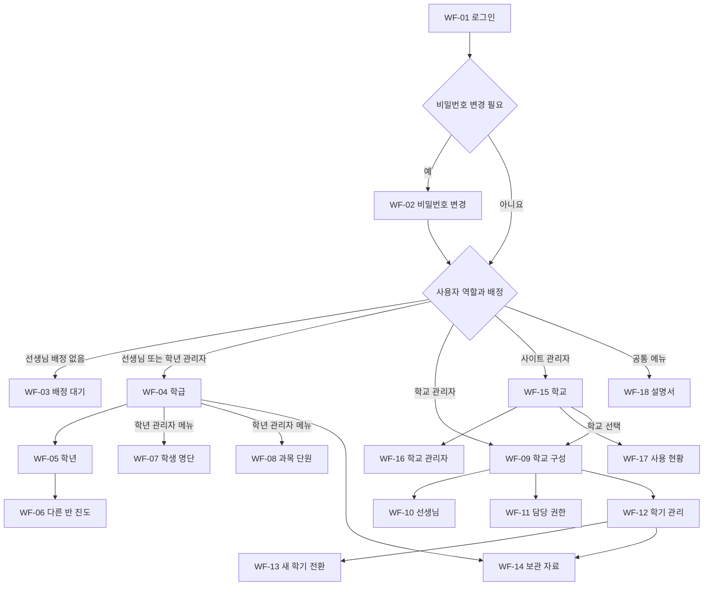

# 학급 진도 대시보드 와이어프레임

작성일: 2026-10-07 · 문서 상태: 구현 전 화면 초안

초등학교 선생님과 관리자가 사용하는 주요 화면 18개의 정보 배치, 이동 경로, 버튼 동작과 상태를 정의한다. [설계서](DESIGN.md)의 권한·진도·학기 보관 규칙을 적용하고, [개발 계획서](PLAN.md)의 화면 구현 기준으로 사용한다.

색상과 최종 디자인을 정하기 전의 구조 설계다. 화면 속 학교·이름·숫자·단원명은 모두 가상 예시다. 학생 상세 화면은 후속 개발이므로 첫 버전의 메뉴나 학생 이름 링크로 노출하지 않는다.

## 1. 읽는 방법과 공통 구성

`[버튼]`은 동작, `[값 ▾]`은 선택기, `[입력: 값]`은 입력란, `[✓]`와 `[ ]`는 편집 가능한 체크박스를 뜻한다. `완료`, `미완료`, `읽기 전용`은 클릭할 수 없는 상태 표시다. 화면 번호는 문서 참조용이며 실제 화면에 표시하지 않는다.

### 공통 화면 틀

```text
┌──────────────────────────────────────────────────────────────┐
│ 학급 진도 대시보드             김선생 · 선생님   [내 계정 ▾] │
├──────────────────────────────────────────────────────────────┤
│ 우리초등학교   [2026학년도 2학기 ▾]   3학년 2반   진행 중    │
├──────────────────────────────────────────────────────────────┤
│ 역할별 메뉴 │ 화면 제목                                      │
│             │ 설명과 현재 작업 범위                          │
│             │ 필터 및 주요 버튼                              │
│             │ 핵심 데이터                                    │
│             │ 저장 상태 또는 오류 안내                       │
└──────────────────────────────────────────────────────────────┘
```

- 학교·학기·학년·학급을 콘텐츠 위에서 항상 확인할 수 있게 한다. 선생님의 학교·학년은 고정 표시이며, 임의의 다른 학교·학년을 선택할 수 없다.
- 학기 선택기는 접근 가능한 학기만 보여준다. 일반 선생님의 현재 담당 반과 다른 반 조회를 화면 제목에서 구분한다.
- `내 계정`에는 비밀번호 변경과 로그아웃을 둔다. 권한을 사용자가 직접 바꾸는 선택기는 두지 않는다.
- 관리자용 학년·학급 선택기는 해당 관리 범위 안에서만 제공한다. 사이트 관리자의 학교 작업 화면에는 선택한 학교와 `전체 학교로` 이동을 표시한다.
- 준비 학기에는 `준비 중 · 진도 기록은 시작 후 가능합니다`, 보관 학기에는 `보관된 학기 · 읽기 전용` 배너를 유지한다.
- 이하 도면은 반복되는 공통 상단과 메뉴를 필요한 경우 생략한 본문 배치다.

### 역할별 기본 메뉴와 시작 화면

| 역할 | 로그인 후 시작 | 메뉴 |
| --- | --- | --- |
| 일반 선생님 | WF-04 담당 학급 | 학급 대시보드, 학년 대시보드, 보관 자료, 사용 설명서 |
| 학년 관리자 | WF-04 담당 학급 | 선생님 메뉴에 학생 명단 관리, 과목·단원 관리 추가 |
| 학교 관리자 | WF-09 학년·학급 관리 | 학년·학급, 선생님, 담당·권한, 학생 명단, 과목·단원, 진도 조회, 학기 관리, 보관 자료, 사용 설명서 |
| 사이트 관리자 | WF-15 학교 관리 | 학교 관리, 학교 관리자 배정, 사이트 사용 현황, 사용 설명서 |

사이트 관리자는 학교를 선택해 해당 학교 관리자 화면과 데이터 관리 기능을 사용할 수 있다. 보관 학기에서 수정 메뉴는 읽기 전용 조회로 바뀌거나 숨겨지며, 직접 수정 화면으로 접근해도 편집할 수 없다.

## 2. 전체 화면 목록과 이동 흐름

| 화면 | 목적 | 접근 대상 | 요구사항 |
| --- | --- | --- | --- |
| WF-01 로그인 | 아이디와 비밀번호 인증 | 비로그인 사용자 | R01 |
| WF-02 비밀번호 변경 | 최초 변경 또는 본인 비밀번호 변경 | 로그인 사용자 | R01 |
| WF-03 배정 대기 | 현재 담당 학급이 없음을 안내 | 미배정 선생님 | R02, R08 |
| WF-04 학급 대시보드 | 담당 반 진도 체크와 명단 조회 | 담당 교사와 범위 내 관리자 | R02, R05 |
| WF-05 학년 대시보드 | 학급별 진도 비교 | 소속 학년 교사와 범위 내 관리자 | R02, R07 |
| WF-06 다른 반 진도 | 단원별 완료 여부 조회 | 같은 학년 교사 | R07 |
| WF-07 학생 명단 관리 | 반별 학생 추가·수정·제외·이동 | 학년 관리자 이상, 담당 범위만 | R03 |
| WF-08 과목·단원 관리 | 학년 공통 교육과정 편집 | 학년 관리자 이상, 담당 범위만 | R03, R04, R05 |
| WF-09 학년·학급 관리 | 학기별 학년·반 구성 | 학교·사이트 관리자 | R08, R09 |
| WF-10 선생님 관리 | 계정 관리와 비밀번호 초기화 | 학교·사이트 관리자 | R08, R09 |
| WF-11 담당·권한 관리 | 담임 배정과 학년 관리자 지정 | 학교·사이트 관리자 | R08, R09 |
| WF-12 학기 관리 | 준비·진행·보관 학기 목록 | 학교·사이트 관리자 | R06 |
| WF-13 새 학기 준비와 전환 | 새 학기 준비 및 이전 학기 보관 | 학교·사이트 관리자 | R06 |
| WF-14 보관 자료 조회 | 과거 학기 기록 열람 | 해당 과거 자료의 열람 권한 보유자 | R06, R07 |
| WF-15 학교 관리 | 학교 생성·수정·비활성화 | 사이트 관리자 | R09 |
| WF-16 학교 관리자 배정 | 학교별 관리자 계정과 권한 관리 | 사이트 관리자 | R09 |
| WF-17 사용 현황 | 전체·학교별 이용 통계 | 사이트 관리자 | R10 |
| WF-18 사용 설명서 | 역할별 기능 안내 | 로그인 사용자 | R11 |



## 3. 로그인과 계정

### WF-01 로그인

```text
┌─────────────────────────────────────────────────────────────┐
│                     학급 진도 대시보드                      │
│               우리 반 수업 진도를 기록하세요.               │
│                                                             │
│ 아이디       [입력: 아이디                              ]   │
│ 비밀번호     [입력: ••••••••                       ] [보기] │
│                                                             │
│                       [로그인]                              │
│                                                             │
│ 비밀번호를 잊으셨나요? [초기화 방법]                        │
│ 계정은 학교 관리자로부터 발급받을 수 있습니다.              │
└─────────────────────────────────────────────────────────────┘
```

로그인 중 버튼 문구를 `로그인 중…`으로 바꾸고 중복 제출을 막는다. 잘못된 입력은 `아이디 또는 비밀번호를 확인해 주세요`로 표시한다. 빈 입력은 해당 필드 아래에서 알려준다. 비밀번호 보기는 누를 때 표시·숨김을 전환한다.

`초기화 방법`은 학교 관리자에게 초기화를 요청하라는 안내를 연다. 일반 사용자의 공개 회원가입이나 이메일 입력 화면은 제공하지 않는다. 로그인 성공 후 최초 비밀번호 변경이 필요하면 WF-02로, 그렇지 않으면 역할별 시작 화면으로 이동한다.

### WF-02 비밀번호 변경

```text
┌───────────────────────────────────────────────────────────┐
│ 비밀번호 변경                                             │
│ 임시 비밀번호를 새 비밀번호로 변경해 주세요.              │
│                                                           │
│ 현재 비밀번호   [입력: ••••••••                         ] │
│ 새 비밀번호     [입력:                                  ] │
│ 새 비밀번호 확인 [입력:                                 ] │
│ 비밀번호 조건 및 입력 오류가 이 위치에 표시됩니다.        │
│                                                           │
│ [로그아웃]                            [변경하고 시작하기] │
└───────────────────────────────────────────────────────────┘
```

최초 변경 시 업무 메뉴와 뒤로 가기를 제공하지 않는다. 변경 완료 후 역할별 시작 화면으로 이동한다. 평소 `내 계정`에서 들어오면 제목 아래 설명을 바꾸고 `취소`와 `변경 저장`을 제공한다. 취소는 직전 화면으로 돌아간다. 두 새 비밀번호가 다르면 확인 입력란 아래에 오류를 표시하고 내용을 지우지 않는다.

### WF-03 담당 학급 배정 대기

```text
┌──────────────────────────────────────────────────────────┐
│ 우리초등학교 · 김선생                                    │
│                                                          │
│ 아직 현재 학기의 담당 학급이 배정되지 않았습니다.        │
│ 학교 관리자에게 학급 배정을 요청해 주세요.               │
│                                                          │
│ [배정 다시 확인]        [보관 자료]        [사용 설명서] │
│                                           [로그아웃]     │
└──────────────────────────────────────────────────────────┘
```

`배정 다시 확인`은 최신 배정을 조회하고, 배정되면 WF-04로 이동한다. 이전 학기의 열람 권한이 있는 경우에만 `보관 자료`를 보여준다. 현재 학교 소속까지 비활성화된 계정에는 보관 자료도 제공하지 않는다. 준비 학기에만 배정되어 있으면 해당 학기를 `준비 중`으로 표시하고 진도 체크를 차단한다.

## 4. 선생님 대시보드

### WF-04 담당 학급 대시보드

```text
┌────────────────────────────────────────────────────────────┐
│ 학급 대시보드                 2026학년도 2학기 · 3학년 2반 │
│ 담당 김선생                               [학년 비교 보기] │
├────────────────────────────────────────────────────────────┤
│ 과목            완료 단원             진도율               │
│ [국어 펼침 ▾]   3 / 8                 37.5%                │
│   [✓] 1단원  작품을 만나요                                 │
│   [✓] 2단원  중심 생각을 찾아요                            │
│   [✓] 3단원  경험을 나눠요                                 │
│   [ ] 4단원  마음을 전해요                                 │
│   ... 나머지 4개 단원                                      │
│   최근 변경: 오늘 10:32 · 김선생             저장 완료     │
│                                                            │
│ [수학 접힘 ▸]   4 / 10                40.0%                │
│ [과학 접힘 ▸]   0 / 6                  0.0%                │
│ [영어 접힘 ▸]   —                     단원 미등록          │
├────────────────────────────────────────────────────────────┤
│ [학생 명단 펼치기 ▾]  총 30명 · 조회 전용                  │
│ 번호   이름                                                │
│ 1      가람                                                │
│ 2      나래                                                │
│ ...                                                        │
└────────────────────────────────────────────────────────────┘
```

- 단원을 체크하거나 해제하면 해당 반의 변경을 즉시 저장한다. 별도 전체 저장 버튼은 두지 않는다.
- 저장 중 해당 체크를 잠그고 `저장 중…`을 표시한다. 저장 성공 후 완료 수와 진도율을 확정한다. 실패하면 이전 체크 상태로 되돌리고 해당 단원 옆에 `저장하지 못했습니다. [다시 시도]`를 표시한다.
- 과목 펼침·접힘은 진도 상태를 바꾸지 않는다. 단원 수가 0이면 체크 영역 대신 `등록된 단원이 없습니다`를 표시한다.
- 일반 선생님에게 학생·단원 추가나 수정 버튼을 보여주지 않는다. 학년 관리자는 자신의 추가 관리 메뉴를 이용한다.
- 학생 이름은 단순 텍스트다. `학년 비교 보기`는 WF-05로 이동한다. 학급 종합 점수나 전체 과목 평균은 표시하지 않는다.
- 학교·사이트 관리자는 학교 관리의 진도 조회에서 학급을 선택해 같은 구성을 사용한다. 자신의 관리 범위와 진행 중 학기 안에서는 진도 수정이 가능하다.

### WF-05 학년 대시보드

```text
┌────────────────────────────────────────────────────────────┐
│ 학년 대시보드                          우리초등학교 3학년  │
│ 2026학년도 2학기          과목 [전체 ▾]        [새로고침]  │
├────────────────────────────────────────────────────────────┤
│ 학급           국어           수학           과학          │
│ [1반]          4/8 50.0%      6/10 60.0%     2/6 33.3%     │
│ [2반 · 내 반]  3/8 37.5%      4/10 40.0%     0/6  0.0%     │
│ [3반]          5/8 62.5%      7/10 70.0%     3/6 50.0%     │
├────────────────────────────────────────────────────────────┤
│ 반 또는 과목 진도를 선택하면 단원별 상태를 볼 수 있습니다. │
│ 마지막 확인 10:32                                          │
└────────────────────────────────────────────────────────────┘
```

`내 반`은 WF-04, 다른 반은 WF-06으로 이동한다. 특정 과목 셀을 선택하면 해당 과목을 펼친 상태로 연다. 반 순서는 반 번호 기준이며 진도율 순위나 평가 표시를 제공하지 않는다. 과목 필터는 표의 표시 열만 바꾸며 데이터를 수정하지 않는다.

일반 선생님·학년 관리자에게 다른 학년 선택기를 제공하지 않는다. 학교·사이트 관리자는 허용된 학교의 학년을 선택할 수 있고, 학급 선택 시 WF-04의 관리자 화면으로 이동한다. 학생 수·학생 이름·학생 상세 링크를 이 비교표에 포함하지 않는다.

### WF-06 같은 학년 다른 반 진도

```text
┌──────────────────────────────────────────────────────┐
│ [학년 대시보드로]                                    │
│ 3학년 1반 진도                      2026학년도 2학기 │
│ 다른 반 진도 · 읽기 전용                             │
├──────────────────────────────────────────────────────┤
│ 국어   4 / 8   50.0%                                 │
│ 완료     1단원  작품을 만나요                        │
│ 완료     2단원  중심 생각을 찾아요                   │
│ 완료     3단원  경험을 나눠요                        │
│ 완료     4단원  마음을 전해요                        │
│ 미완료   5단원  이야기를 이어가요                    │
│ ...                                                  │
│ [수학 펼치기 ▸]  6 / 10   60.0%                      │
└──────────────────────────────────────────────────────┘
```

완료 상태는 조작할 수 없는 텍스트로 표시한다. 일반 선생님뿐 아니라 학년 관리자도 여기서 다른 반의 진도를 수정하지 못한다. 이 화면에는 학생 명단이 없다. 학년 관리자가 다른 반 명단을 관리할 때는 WF-07을 사용한다. 돌아갈 때 WF-05의 과목 필터를 유지한다.

## 5. 학년 관리자 화면

### WF-07 학생 명단 관리

```text
┌─────────────────────────────────────────────────────────────┐
│ 학생 명단 관리                     2026학년도 2학기 3학년   │
│ 반 [2반 ▾]   상태 [재적 ▾]   이름 검색 [입력:        ]      │
│ 적용 범위: 3학년 2반                         [학생 추가]    │
├─────────────────────────────────────────────────────────────┤
│ 번호   이름       상태     동작                             │
│ 1      가람       재적     [수정] [반 이동] [명단에서 제외] │
│ 2      나래       재적     [수정] [반 이동] [명단에서 제외] │
│ ...                                                         │
│ 총 30명                             [이전] 1 / 2 [다음]     │
└─────────────────────────────────────────────────────────────┘
```

`학생 추가`와 `수정`은 같은 입력창을 사용한다.

```text
┌────────────────────────────────────────────────────────────┐
│ 학생 추가                                           [닫기] │
│ 우리초등학교 · 2026학년도 2학기 · 3학년 2반                │
│ 번호 [입력: 31 ]     이름 [입력:                       ]   │
│ 이 학생은 선택한 반 명단에만 추가됩니다.                   │
│                                      [취소] [학생 추가]    │
└────────────────────────────────────────────────────────────┘
```

같은 반의 번호 중복은 입력란 아래에 오류로 표시한다. 동명이인은 허용한다. `반 이동`은 현재 반, 이동할 반, 새 번호를 입력받고 확인 후 저장한다. 학년 관리자는 같은 학년 안에서만 이동시킬 수 있다. 다른 학년 이동은 학교·사이트 관리자에게만 제공한다.

`명단에서 제외`는 학생 이름·반과 함께 `현재 명단에서 제외하며 기존 기록은 보존합니다`를 확인한 뒤 처리한다. `상태: 제외됨`에서 복구할 수 있다. 복구 시 번호 충돌이 있으면 새 번호를 받는다. 학생 이동이나 제외는 학급 단원 진도를 바꾸지 않는다.

일반 선생님은 이 메뉴와 수정 요청을 사용할 수 없다. 보관 학기에는 검색·필터만 제공하고 모든 편집 동작을 숨긴다. 준비 학기에서는 배정된 학년 관리자가 편집할 수 있다.

### WF-08 과목 및 단원 관리

```text
┌───────────────────────────────────────────────────────────┐
│ 과목·단원 관리                     2026학년도 2학기 3학년 │
│ 이 교육과정은 3학년 전체 3개 학급에 공통 적용됩니다.      │
│ 상태 [사용 중 ▾]                           [과목 추가]    │
├───────────────────────────────────────────────────────────┤
│ 과목 목록        │ 수학 · 총 10개 단원                    │
│ 국어 [↑] [↓]     │ [과목 수정] [사용 중지] [단원 추가]    │
│ 수학 선택        │                                        │
│ 과학 [↑] [↓]     │ 순서  단원명          동작             │
│ 영어 [↑] [↓]     │ 1     곱셈            [수정] [↑] [↓]   │
│                  │                       [사용 중지]      │
│                  │ 2     나눗셈          [수정] [↑] [↓]   │
│                  │                       [사용 중지]      │
│                  │ ...                                    │
└───────────────────────────────────────────────────────────┘
```

과목 추가·수정은 이름과 순서, 단원 추가·수정은 제목과 순서를 입력받는다. 순서 변경은 화면에 임시 반영하고 목록 하단의 `순서 저장`으로 확정한다. 입력값을 바꾸고 저장하지 않은 상태로 화면을 나가려면 `계속 편집` 또는 `변경 취소 후 이동`을 선택한다.

단원 추가와 사용 중지처럼 진도율이 달라지는 작업은 영향 확인을 거친다.

```text
┌─────────────────────────────────────────────────────────────┐
│ 새 단원 추가 확인                                    [닫기] │
│ 수학 · 새 단원: 분수                                        │
│ 적용: 우리초등학교 / 2026학년도 2학기 / 3학년 전체 3개 반   │
│ 전체 단원 10개 → 11개 · 새 단원은 모든 반에서 미완료        │
│                                                             │
│ 1반   6/10 60.0% → 6/11 54.5%                               │
│ 2반   4/10 40.0% → 4/11 36.4%                               │
│ 3반   7/10 70.0% → 7/11 63.6%                               │
│                             [돌아가기] [전체 학년에 적용]   │
└─────────────────────────────────────────────────────────────┘
```

제목·순서만 바꾸면 완료 상태와 진도율은 유지된다고 안내한다. 사용 중지 시 현재 계산에서 제외되고 기존 완료 기록은 보존된다고 설명한다. `상태: 사용 중지`에서 `복구`하면 이전 완료 상태도 복원된다. 과목 사용 중지는 포함된 단원 전체의 표시에도 영향을 준다고 안내한다.

저장 후 최신 공통 목록과 적용 완료 안내를 표시한다. 보관 학기에는 추가·수정·사용 중지·복구·순서 저장을 모두 제공하지 않는다. 일반 선생님은 과목·단원 목록을 대시보드에서 조회하며 이 관리 화면은 사용할 수 없다.

## 6. 학교 관리자 화면

### WF-09 학년 및 학급 관리

```text
┌────────────────────────────────────────────────────────────┐
│ 학년·학급 관리                  우리초등학교               │
│ [2026학년도 2학기 ▾]   진행 중                 [학년 추가] │
├────────────────────────────────────────────────────────────┤
│ [3학년 펼침 ▾]               [학급 추가] [학년 사용 중지]  │
│ 학급   담당 교사   학생 수   동작                          │
│ 1반    이선생     30명     [이름 수정] [담당 배정]         │
│ 2반    김선생     30명     [이름 수정] [담당 배정]         │
│ 3반    박선생     30명     [이름 수정] [담당 배정]         │
│ 각 학급의 추가 동작: [사용 중지]                           │
│                                                            │
│ [4학년 펼치기 ▸]   3개 학급                                │
└────────────────────────────────────────────────────────────┘
```

학년 추가는 학년 번호, 학급 추가는 대상 학년과 반 번호·이름을 입력받는다. 같은 학기·학년 안의 중복을 입력 단계에서 안내한다. `담당 배정`은 해당 반을 선택한 WF-11로 이동한다.

사용 중지 전 연결된 학생·담당·진도 정보를 요약한다. 재적 학생과 활성 담당 배정이 남아 있으면 이동·배정 정리 화면을 안내하고 중지를 막는다. 과거 진도 기록은 삭제하지 않는다. 사용 중지한 학급을 포함하는 상태 필터와 복구 동작을 제공한다. 학교 관리자는 여기에서 학교를 생성하거나 다른 학교로 전환할 수 없다.

### WF-10 선생님 계정 관리

```text
┌─────────────────────────────────────────────────────────────┐
│ 선생님 관리                                   [계정 추가]   │
│ 우리초등학교 · 현재 학기 배정 기준                          │
│ 학년 [전체 ▾]  상태 [활성 ▾]  검색 [입력: 이름 또는 아이디] │
├─────────────────────────────────────────────────────────────┤
│ 이름     아이디       담당       권한         동작          │
│ 이선생   lee.teacher  3학년 1반  선생님      [관리 ▾]       │
│ 김선생   kim.teacher  3학년 2반  학년 관리자 [관리 ▾]       │
│ 최선생   choi.teacher 미배정     선생님      [관리 ▾]       │
│ 관리: 정보 수정 / 담당 배정 / 비밀번호 초기화 / 비활성화    │
└─────────────────────────────────────────────────────────────┘
```

계정 추가 입력은 이름·아이디·임시 비밀번호다. 성공 후 발급 내용을 확인하고, `담당 배정하기`로 WF-11에 연결한다. 학교 관리자에게 사이트 관리자 권한을 선택하는 필드는 제공하지 않는다. 학년 관리자 지정도 이 계정 폼이 아닌 WF-11에서 처리한다.

`비밀번호 초기화`는 대상 이름·아이디와 `기존 세션이 종료되고 다음 로그인 때 비밀번호를 변경해야 합니다`를 표시한다. 실행 성공 시 새 임시 비밀번호를 전달할 수 있는 확인 창을 제공하며, 확인 창을 닫은 뒤 목록에서 비밀번호를 다시 조회할 수는 없다.

비활성화 전 현재 담당 학급·학년 관리자 역할을 보여주고 대체 배정이 필요하면 WF-11로 연결한다. 비활성화된 계정의 과거 이력은 유지한다. `상태: 비활성` 필터에서 재활성화할 수 있으며 담당 배정은 다시 확인한다. 학년 필터에 `미배정`을 포함한다.

### WF-11 담당 학급 및 학년 관리자 지정

```text
┌────────────────────────────────────────────────────────────┐
│ 담당·권한 관리                2026학년도 2학기 · [3학년 ▾] │
├────────────────────────────────────────────────────────────┤
│ 학급 담당                                                  │
│ 1반   현재 이선생        새 담당 [이선생 ▾]                │
│ 2반   현재 김선생        새 담당 [김선생 ▾]                │
│ 3반   현재 박선생        새 담당 [박선생 ▾]                │
│                                                            │
│ 학년 관리자                                                │
│ 현재 김선생              새 관리자 [김선생 ▾]              │
│ 해당 학년에 배정된 선생님 중 한 명을 지정합니다.           │
│                                                            │
│ 변경 요약: 아직 변경한 항목이 없습니다.                    │
│                                  [변경 취소] [배정 저장]   │
└────────────────────────────────────────────────────────────┘
```

교사 선택기는 같은 학교의 활성 계정만 제공하고, 다른 반 담당자는 현재 배정을 함께 표시한다. 한 교사를 두 반에 중복 배정하면 해당 행에 오류를 보여준다. 학년 관리자 후보는 저장할 배정 결과에서 해당 학년을 담당하는 교사로 제한한다.

기존 학년 관리자가 다른 학년으로 이동하거나 배정 해제되면 대체 관리자 지정도 함께 요구한다. 저장 전 변경되는 반·기존 담당·새 담당·관리자 교체를 요약하고 한 번에 저장한다. 성공 후 `배정이 저장되었습니다. 변경된 권한은 다음 요청부터 적용됩니다`를 안내한다.

## 7. 학기 준비와 보관 화면

### WF-12 학기 관리

```text
┌────────────────────────────────────────────────────────────┐
│ 학기 관리                 우리초등학교      [새 학기 준비] │
│ 현재 진행 중: 2026학년도 2학기                             │
├────────────────────────────────────────────────────────────┤
│ 학년도   학기   상태       동작                            │
│ 2027     1      준비 중    [준비 계속하기]                 │
│ 2026     2      진행 중    [학급 현황 보기]                │
│ 2026     1      보관       [보관 자료 보기]                │
├────────────────────────────────────────────────────────────┤
│ 다음 학기를 시작하면 현재 학기는 읽기 전용으로 보관됩니다. │
└────────────────────────────────────────────────────────────┘
```

`새 학기 준비`는 WF-13의 첫 단계, `준비 계속하기`는 저장된 준비 단계, `보관 자료 보기`는 WF-14로 이동한다. 같은 연도·학기를 다시 만들려고 하면 기존 준비 학기를 안내한다. 보관 해제·보관 자료 삭제 버튼은 두지 않는다. 최초 학교 설정처럼 진행 중 학기가 없으면 `첫 학기 준비`를 주요 버튼으로 보여준다.

### WF-13 새 학기 준비와 전환

상단에 `기본 정보 → 복사 선택 → 준비 점검 → 전환 확인`의 네 단계를 표시한다. 준비 데이터를 저장한 뒤 나가도 WF-12에서 이어갈 수 있다. 마지막 전환 전까지 기존 학기를 계속 사용할 수 있다.

#### 1단계 기본 정보

```text
┌───────────────────────────────────────────────────────┐
│ 새 학기 준비 · 1/4 기본 정보                          │
│ 학교: 우리초등학교                                    │
│ 현재 학기: 2026학년도 2학기                           │
│ 새 학년도 [입력: 2027 ]      새 학기 [1학기 ▾]        │
│ 시작일 [날짜 선택]           종료일 [날짜 선택]       │
│ 날짜를 입력해도 학기가 자동으로 시작되지는 않습니다.  │
│                                [학기 목록으로] [다음] │
└───────────────────────────────────────────────────────┘
```

동일 학교의 중복 학기를 차단하고, 이전 학기보다 뒤의 학기인지 확인한다. 시작일이 종료일보다 늦으면 입력란 아래에 안내한다. 최초 시작에는 현재 학기 대신 `첫 학기 개설`을 표시한다.

#### 2단계 복사할 정보 선택

```text
┌────────────────────────────────────────────────────────┐
│ 새 학기 준비 · 2/4 복사 선택                           │
│ 원본: 2026학년도 2학기 → 대상: 2027학년도 1학기        │
│ [✓] 학년·학급 구조 복사                                │
│ [✓] 과목 목록 복사                                     │
│ [ ] 단원 목록 복사                                     │
│ 학생 명단: 새 학년도 명단을 새로 편성합니다.           │
│ 교사·학년 관리자: 새 학년도의 담당을 다시 배정합니다.  │
│ 진도: 모든 단원 미완료로 시작합니다.                   │
│                          [이전] [선택한 내용으로 준비] │
└────────────────────────────────────────────────────────┘
```

같은 학년도 1학기에서 2학기로 넘어가는 경우에는 `학생 명단 복사` 선택을 추가하고, 교사·학년 관리자 배정 후보도 다음 단계에서 확인할 수 있게 한다. 새 학년도에는 자동 진급과 자동 반 배정을 하지 않는다. 단원 복사는 과목 복사와 함께 선택되도록 한다.

복사 결과는 준비 학기에 저장한다. 재실행 시 이미 편집한 값을 덮어쓰지 않으며 복사된 항목을 중복 생성하지 않는다. 기존 학기 자료가 이후 바뀌면 준비 점검에 차이 안내를 표시한다.

#### 3단계 준비 점검

```text
┌─────────────────────────────────────────────────────────────┐
│ 새 학기 준비 · 3/4 준비 점검          2027학년도 1학기      │
├─────────────────────────────────────────────────────────────┤
│ 학급 구성       6개 반 준비됨            [학급 관리]        │
│ 교사 배정       5/6 완료 · 4학년 3반 미배정 [담당 배정]     │
│ 학년 관리자    2/2 지정 완료             [권한 관리]        │
│ 학생 명단       등록 전                  [명단 관리]        │
│ 과목·단원       일부 과목의 단원 미등록   [단원 관리]       │
├─────────────────────────────────────────────────────────────┤
│ 필수: 담당 교사 배정을 완료해 주세요.                       │
│ 안내: 학생·단원 미등록 항목은 시작 후에도 등록 가능합니다.  │
│                             [나중에 계속] [다음: 사용 불가] │
└─────────────────────────────────────────────────────────────┘
```

관리 버튼은 대상 준비 학기를 유지한 채 WF-09·WF-11·WF-07·WF-08로 이동한다. 돌아오면 점검 결과를 갱신한다. 학년 관리자는 배정된 준비 학기의 명단과 단원을 자신의 관리 화면에서 준비할 수 있다.

필수 배정·중복·권한 문제가 해결되면 `다음`을 활성화한다. 학생·단원 미등록은 경고로 남기고 다음 단계로 진행할 수 있다. 화면에는 완료 상태와 문제 내용을 텍스트로 함께 표시한다.

#### 4단계 보관 및 전환 확인

```text
┌────────────────────────────────────────────────────────────────┐
│ 새 학기 준비 · 4/4 전환 확인                                   │
├────────────────────────────────────────────────────────────────┤
│ 보관할 학기: 2026학년도 2학기                                  │
│ 학급 6개 · 학생 180명 · 해당 학기의 단원과 진도 보존           │
│ 보관 후에는 이 학기 정보를 수정할 수 없습니다.                 │
│                                                                │
│ 시작할 학기: 2027학년도 1학기                                  │
│ 학급 6개 · 교사 배정 6/6 · 학년 관리자 2/2                     │
│ 학생 명단 미등록 · 단원 미등록 과목 있음                       │
│ 새 학기 진도는 미완료로 시작합니다.                            │
│                                                                │
│                        [이전] [현재 학기 보관 후 새 학기 시작] │
└────────────────────────────────────────────────────────────────┘
```

마지막 버튼이 전환 실행 동작이다. 진행 중에는 `학기를 전환하고 있습니다…`를 표시하고 중복 실행을 막는다. 성공하면 새 학기·보관 학기를 명시한 완료 화면에서 `새 학기 관리`와 `보관 자료 보기`를 제공한다.

실패 결과가 확인되면 `학기 전환을 완료하지 못했습니다. 기존 학기는 계속 사용 가능합니다`와 재시도를 제공한다. 통신이 끊겨 완료 여부를 아직 모르면 실패로 단정하지 않고 `처리 결과 확인 중`으로 표시한다. 서버에서 결과를 확인한 뒤 완료 화면 또는 같은 요청의 재시도로 연결한다.

최초 학기 개설에는 보관 영역을 생략하고 마지막 버튼을 `첫 학기 시작`으로 표시한다. 전환 후 열린 이전 학기 화면에서 저장을 시도하면 보관 안내와 현재 학기로 이동하는 동작을 제공한다.

### WF-14 보관 자료 조회

```text
┌─────────────────────────────────────────────────────────────┐
│ 보관 자료                                                   │
│ 학년도 [2026 ▾]  학기 [1학기 ▾]   조회 범위: 당시 3학년 2반 │
├─────────────────────────────────────────────────────────────┤
│ 보관된 학기 · 읽기 전용                                     │
│ 보관 당시 우리초등학교 / 3학년 2반 / 담당 김선생            │
│ 보관 일시 2026-08-24 09:00                                  │
│                                                             │
│ [학급 진도]   [학년 진도]   [학생 명단]                     │
│ 과목        완료 단원       진도율                          │
│ [국어 ▾]    8 / 8         100.0%                            │
│ [수학 ▾]    9 / 10         90.0%                            │
│ 단원을 펼치면 당시 완료·미완료 상태가 표시됩니다.           │
│                                      [현재 학기로 돌아가기] │
└─────────────────────────────────────────────────────────────┘
```

일반 선생님은 해당 학기 본인 담당 반 명단과 당시 학년 진도만 열람한다. 당시 학년 관리자였고 이력 열람 권한이 있으면 해당 학년의 반을 선택해 명단을 볼 수 있다. 학교·사이트 관리자는 자신의 관리 범위에 맞춰 학년·반 선택기를 사용한다.

보관 자료는 WF-04·WF-05·WF-07·WF-08의 읽기 전용 구성을 재사용한다. 학교·교사·학생·단원 이름은 당시 값을 사용한다. 학생 관리와 진도 체크 등 변경 버튼은 모두 숨긴다. 권한이 없는 과거 학기는 선택 목록에 표시하지 않으며 직접 접근도 차단한다. 현재 학기 배정이 없으면 돌아가기 대상은 WF-03이다.

## 8. 사이트 관리자 화면

### WF-15 전체 학교 관리

```text
┌──────────────────────────────────────────────────────────┐
│ 학교 관리                                  [학교 추가]   │
│ 검색 [입력: 학교명       ]      상태 [사용 중 ▾]         │
├──────────────────────────────────────────────────────────┤
│ 학교          담당 관리자   진행 중 학기      동작       │
│ 우리초등학교  관리자 가     2026-2          [학교 관리]  │
│                                              [더 보기 ▾] │
│ 나래초등학교  미지정        학기 미설정      [학교 관리] │
│                                              [더 보기 ▾] │
│ 더 보기: 정보 수정 / 관리자 배정 / 사용 현황 / 사용 중지 │
└──────────────────────────────────────────────────────────┘
```

`학교 추가`는 학교 이름을 입력받아 생성하고 `학교 관리자 배정`으로 연결한다. `학교 관리`는 해당 학교를 명시한 WF-09, `사용 현황`은 해당 학교로 필터링한 WF-17을 연다. 학교 이름 수정은 보관 학기의 당시 표시 이름을 바꾸지 않는다.

사용 중지 확인에는 학교명과 해당 학교 사용자의 접근이 중단됨을 표시한다. 기존 기록은 유지한다. `상태: 사용 중지`에서 다시 사용하도록 복구할 수 있다. 비활성 학교를 실제 이용자가 이용할 수 있는 것처럼 표시하지 않는다.

### WF-16 학교 관리자 계정과 배정

```text
┌──────────────────────────────────────────────────────────────┐
│ 학교 관리자 배정                       학교 [우리초등학교 ▾] │
├──────────────────────────────────────────────────────────────┤
│ 현재 관리자                                                  │
│ 이름        아이디            상태        동작               │
│ 관리자 가   school.admin.a    활성        [관리 ▾]           │
│ 관리: 정보 수정 / 비밀번호 초기화 / 관리자 권한 해제         │
│                                                              │
│ [새 관리자 계정 생성]     [기존 소속 계정에 권한 부여]       │
└──────────────────────────────────────────────────────────────┘
```

새 계정 생성은 이름·아이디·임시 비밀번호를 받는다. 기존 계정 선택은 해당 학교의 활성 소속 계정만 제시한다. 부여 또는 해제 전에 대상 계정과 학교 범위를 확인하고 저장한다. 화면에서 사이트 관리자 권한을 함께 부여하는 옵션은 제공하지 않는다.

교체할 때는 새 관리자 지정 후 기존 권한을 해제하도록 안내해 담당자 공백을 방지한다. 계정 비활성화와 학교 관리자 권한 해제를 구분해서 설명한다. 비밀번호 초기화 동작은 WF-10의 확인 흐름을 재사용한다.

### WF-17 사이트 및 학교별 사용 현황

```text
┌────────────────────────────────────────────────────────────┐
│ 사용 현황          학교 [전체 ▾]         [새로고침]        │
│ 일별 조회 날짜 [2026-10-07]             기준: 한국 시간    │
├────────────────────────────────────────────────────────────┤
│ 선택일 이용자 10명    선택일 로그인 18회    현재 접속 5명  │
│ 현재 접속: 최근 5분 안에 활동한 사용자                     │
├────────────────────────────────────────────────────────────┤
│ 학교          활성 계정   선택일 이용자  로그인  최근 이용 │
│ [우리초등학교] 8명         6명          11회    오늘 14:20 │
│ [나래초등학교] 6명         4명           7회    오늘 14:18 │
├────────────────────────────────────────────────────────────┤
│ 마지막 갱신: 2026-10-07 14:20    [집계 기준 보기]          │
└────────────────────────────────────────────────────────────┘
```

학교명을 선택하면 학교 필터를 적용한다. 학교가 하나 선택된 경우 해당 학교의 동일 지표와 최근 7일의 일별 이용자·로그인 표를 아래에 제공한다. 전체 학교로 돌아가는 동작을 필터 옆에 둔다.

선택일 이용자와 로그인 횟수는 선택 날짜 기준이고, 현재 접속·활성 계정·최근 이용은 현재 시점 기준이다. 과거 날짜를 선택해도 현재 접속 수를 과거 수치로 오해하지 않도록 카드에 `현재`를 유지한다. 데이터가 없으면 `0`과 `이용 기록 없음`, 불러오기 실패면 오류와 `다시 시도`를 구분한다.

`집계 기준 보기`에는 이용자는 계정당 한 명, 로그인은 성공 횟수, 현재 접속은 최근 활동 기준이라는 설명을 제공한다. 개인 학생 명단이나 사용자별 활동 추적 화면은 포함하지 않는다. 학교 관리자와 선생님에게 이 사이트 관리 메뉴를 노출하지 않는다.

## 9. 설명서와 공통 상태

### WF-18 사용 설명서

```text
┌────────────────────────────────────────────────────────────┐
│ 사용 설명서                         검색 [입력:         ]  │
│ 내 역할: 학년 관리자                                       │
├────────────────────────────────────────────────────────────┤
│ 목차                    │ 단원을 추가하면 무엇이 바뀌나요? │
│ [처음 시작하기]         │                                  │
│ [진도 체크와 해제]      │ 같은 학년의 모든 반에 새 단원이  │
│ [학생 명단 관리]        │ 추가됩니다.                      │
│ [과목·단원 관리]        │                                  │
│ [보관 자료 보기]        │ 완료한 단원 수가 같아도 전체     │
│ [자주 묻는 질문]        │ 단원 수가 늘면 진도율은          │
│                         │ 낮아질 수 있습니다.              │
│                         │                                  │
│                         │ [과목·단원 관리로 이동]          │
└────────────────────────────────────────────────────────────┘
```

목차는 자신의 역할에 필요한 항목을 우선 표시한다. 화면에서 `도움말`로 들어오면 해당 주제를 바로 연다. 설명서의 작업 화면 이동 버튼도 현재 권한과 학기 상태를 적용한다. 권한이 없으면 버튼 대신 담당 관리자에게 요청할 방법을 설명한다.

학교 관리자 설명서에는 계정·담당 배정과 학기 전환, 사이트 관리자 설명서에는 학교 개설·관리자 배정·통계 기준을 추가한다. 검색 결과가 없으면 `검색어를 바꾸거나 목차에서 찾아보세요`를 표시한다.

### 저장과 조회의 공통 상태

| 상태 | 화면 표시 | 가능한 동작 |
| --- | --- | --- |
| 최초 불러오는 중 | 표·카드 자리에 로딩 표시 | 중복 로드 버튼 잠금 |
| 조회 실패 | 데이터를 불러오지 못했습니다 | 다시 시도 |
| 저장 중 | 저장 중… 및 해당 버튼 잠금 | 같은 항목 중복 저장 차단 |
| 저장 완료 | 저장 완료 및 갱신 시각 | 다음 작업 |
| 저장 실패 | 저장되지 않았습니다 | 입력 유지 또는 체크 원복, 다시 시도 |
| 동시 수정 충돌 | 다른 사용자가 내용을 변경했습니다 | 최신 내용 확인 후 다시 수정 |
| 권한 회수 | 이 화면을 이용할 권한이 변경되었습니다 | 허용된 시작 화면으로 이동 |
| 세션 만료 | 다시 로그인해 주세요 | WF-01로 이동 |
| 학기 보관 완료 | 보관된 학기는 변경할 수 없습니다 | 읽기 전용 조회 또는 현재 학기로 이동 |
| 전환 결과 미확인 | 학기 전환 처리 결과 확인 중 | 결과 확인, 중복 새 전환 차단 |

권한이 없는 주소로 직접 접근한 경우 학교명·학생명·진도를 오류 화면에 노출하지 않는다. `접근할 수 없는 화면입니다`와 허용된 시작 화면으로 이동하는 버튼만 제공한다. 세션 만료 후 돌아갈 때도 접근 권한을 다시 확인한다.

### 처음 사용하는 학교와 빈 데이터

| 위치 | 빈 상태 문구 | 다음 동작 |
| --- | --- | --- |
| 사이트 학교 목록 | 등록된 학교가 없습니다 | 학교 추가 |
| 학교의 학기 목록 | 아직 학기가 설정되지 않았습니다 | 첫 학기 준비 |
| 학년·학급 목록 | 이 학기에 등록된 학급이 없습니다 | 학급 추가 |
| 담당 반 학생 명단 | 등록된 학생이 없습니다 | 일반 교사는 관리자 문의, 학년 관리자는 명단 관리 |
| 과목 목록 | 등록된 과목이 없습니다 | 편집 권한자는 과목 추가, 일반 교사는 안내만 |
| 과목의 단원 목록 | 단원이 등록되지 않았습니다 | 편집 권한자는 단원 관리, 일반 교사는 안내만 |
| 학년 진도 비교 | 비교할 학급이 없습니다 | 관리자에게 학급 구성 안내 |
| 보관 자료 | 조회 가능한 보관 학기가 없습니다 | 현재 학기로 돌아가기 또는 시작 화면 |
| 검색 결과 | 조건에 맞는 항목이 없습니다 | 검색·필터 초기화 |

접근할 수 있는 데이터가 없다는 것을 진도 `0%`와 혼동하지 않게 한다. 단원 미등록은 `—`, 단원이 있지만 아무것도 완료하지 않았다면 `0/전체 수 · 0.0%`로 표시한다.

## 10. 화면 크기와 조작 규칙

### 좁은 화면의 학급 대시보드

```text
┌──────────────────────────────────┐
│ [메뉴] 학급 진도       [내 계정] │
│ 우리초등학교 · 3학년 2반         │
│ [2026학년도 2학기 ▾]   진행 중   │
├──────────────────────────────────┤
│ 국어              3/8 · 37.5%    │
│ [진도 막대]                      │
│ [✓] 1단원  작품을 만나요         │
│ [✓] 2단원  중심 생각을 찾아요    │
│ [✓] 3단원  경험을 나눠요         │
│ [ ] 4단원  마음을 전해요         │
│ ...                              │
│ 저장 완료                        │
├──────────────────────────────────┤
│ [수학 펼치기 ▸]   4/10 · 40.0%   │
│ [학생 명단 펼치기 ▸]             │
└──────────────────────────────────┘
```

PC는 좌측 메뉴와 넓은 본문, 태블릿은 접을 수 있는 메뉴를 기본으로 한다. 좁은 화면은 메뉴를 서랍으로 열고 과목별 카드를 한 열로 배치한다. 구체적인 전환 너비는 실제 화면 구현에서 긴 단원명과 한국어 표시를 보며 조정한다.

학년 비교표는 학급명 열을 고정하고 과목 열만 가로 스크롤한다. 모든 과목이 화면에 보이지 않으면 `옆으로 이동해 다른 과목을 확인하세요`를 표시한다. 관리 화면의 긴 표는 학급·이름과 주요 동작이 함께 보이는 카드로 바꾸거나 가로 스크롤을 사용한다. 좁은 화면의 입력창은 전체 화면 형태로 열고 제목·취소·저장을 유지한다.

- 클릭 영역은 충분히 넓게 확보하고, 단원 이름을 눌러도 연결된 체크박스를 조작할 수 있게 한다.
- 완료 여부, 오류, 준비·보관 상태는 색상과 함께 텍스트로 표시한다.
- 체크박스와 버튼은 키보드로 접근하고 현재 초점을 확인할 수 있어야 한다.
- 입력창에는 필드 이름을 항상 표시한다. 설명을 입력칸의 임시 문구에만 의존하지 않는다.
- 모달을 열면 첫 입력 또는 제목으로 초점을 옮기고, 닫으면 열었던 버튼으로 돌려준다. 입력 오류 시 해당 필드를 안내한다.
- 변경하지 않은 폼은 바로 닫고, 저장하지 않은 변경이 있으면 폐기 여부를 확인한다. 조회 필터 변경에는 확인 창을 띄우지 않는다.
- 일반 진도 체크에는 매번 확인 창을 띄우지 않는다. 학년 전체에 영향을 주는 변경, 명단 제외, 권한 변경, 학기 전환에는 대상과 결과를 확인할 수 있게 한다.
- 단원 순서 변경은 드래그 기능 없이도 위·아래 버튼으로 가능하게 한다.

## 11. 화면 검토 기준

- [ ] WF-01~WF-18의 진입 메뉴와 돌아가기 동작이 연결되어 있다.
- [ ] 일반 선생님의 화면에는 학생·단원 편집 버튼이 없다.
- [ ] 학년 관리자는 다른 반 진도를 수정할 수 없지만 담당 학년 명단·단원은 관리할 수 있다.
- [ ] 다른 반 진도 화면과 학년 비교표에 학생 이름·명단이 노출되지 않는다.
- [ ] 모든 편집 화면에서 학교·학기·학년·반의 적용 범위를 확인할 수 있다.
- [ ] 완료 수와 전체 단원 수, 진도율이 일치하며 단원 미등록을 구분한다.
- [ ] 학년 공통 단원 변경의 영향과 저장 후 상태가 명확하다.
- [ ] 준비 학기에서는 진도를 기록할 수 없고 보관 학기에서는 모든 변경이 막힌다.
- [ ] 같은 학년도 다음 학기와 다음 학년도 준비의 복사 규칙이 다르다.
- [ ] 학기 전환 확인에 보관 대상과 새 학기 진도 초기화가 명시되어 있다.
- [ ] 학기 전환의 실패와 완료 여부 미확인을 다른 상태로 안내한다.
- [ ] 권한별 보관 자료 열람 범위와 당시 이름 표시가 유지된다.
- [ ] 현재 접속 수와 선택 날짜의 이용 통계를 혼동하지 않는다.
- [ ] 빈 상태·로딩·저장 실패·권한 변경에 다음 동작이 있다.
- [ ] 좁은 화면과 키보드 조작에서도 주요 작업이 가능하다.

이 체크리스트는 구현·화면 검토 시 사용할 기준이며 현재 앱 동작 검증의 완료 표시가 아니다. 최종 색상·서체·아이콘과 상세 간격은 이 구조를 바탕으로 별도 UI 디자인 단계에서 정한다.
